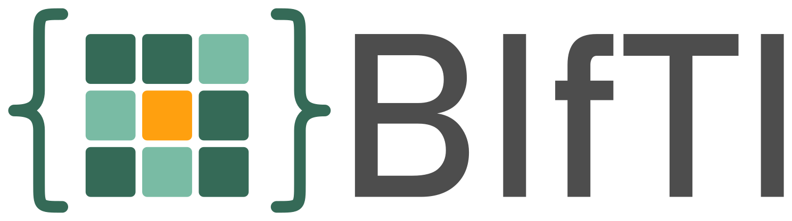

*Bloch Informatics Technology Initiative* phantom format - a playful riff on **NIfTI**, but specific to MRI simulation data.

A universal, implementation-agnostic format for storing MRI simulation phantoms.
A phantom is one **JSON** file defining tissues and their MR properties, referencing **NIfTI** files for per-voxel data.

> [!IMPORTANT]
> **Goals**
> - _easy to use:_ Human readable configs, existing viewers for 3D tissue data
> - _easy to share:_ Strict spec ensures consistent phantom structuring
> - _easy to extend:_ General approach supports future extensions
> - _easy to implement:_ JSON and NIfTI are widely supported

> [!INFO] Status
> phantom spec: **v1** (see [SPEC.md](SPEC.md))\
> [registry format](#registry): **v1** (see [REGISTRY.md](REGISTRY.md))

## Quick example

A minimal phantom is a JSON sidecar next to its NIfTI(s) — one tissue,
`density` from a NIfTI file, everything else a plain number:

```json
{
  "$schema": "https://raw.githubusercontent.com/mrx-org/bifti-phantoms/refs/heads/main/bifti-phantom-v1.schema.json",
  "units":  { "gyro": "MHz/T", "B0": "T", "T1": "s", "T2": "s", "T2'": "s", "ADC": "10^-3 mm^2/s", "dB0": "Hz", "B1+": "rel", "B1-": "rel" },
  "system": { "gyro": 42.5764, "B0": 3.0 },
  "tissues": {
    "gm": { "density": "subj42.nii.gz[0]", "T1": 1.56, "T2": 0.083 }
  }
}
```

Loading phantoms from...

<details>
<summary>Python</summary>

```python
from bifti import NumpyPhantom

phantom = NumpyPhantom.load("subj42.json")
tissue = phantom.tissues["gm"]  # a NumpyTissue: density, T1, T2, ... as np.ndarray
print(tissue.shape, tissue.T1.mean())
```
</details>
<details>
<summary>Julia</summary>

```julia
using BiftiPhantoms

phantom = load_bifti("subj42.json")
tissue = phantom.tissues["gm"]  # a VoxelTissue: density, T1, T2, ... as arrays
println(size(tissue), " ", sum(tissue.T1) / length(tissue.T1))
```
</details>
<details>
<summary>MATLAB or Octave</summary>

```matlab
phantom = bifti.loadPhantom('subj42.json');
gm = phantom.tissues(strcmp({phantom.tissues.name}, 'gm'));  % density, T1, T2, ... as arrays
disp(mean(gm.T1(:)))
```
</details>
<details>
<summary>Rust</summary>

```rust
use bifti::{Phantom, VolumeData};

let phantom = Phantom::load("subj42.json")?;
let tissue = &phantom.tissues["gm"];
if let VolumeData::Float64(t1) = &tissue.t1.data {
    println!("{:?} {}", tissue.density.shape, t1.iter().sum::<f64>() / t1.len() as f64);
}
```
</details>

## Add your own phantoms

> [!TIP]
> **Sharing a phantom in three simple steps:**
> 1. **Zenodo:** upload your NIfTI + JSON files and publish it.
> 2. **[registry.json](registry.json):** add a new entry with the Zenodo DOI (permanent archive).
> 3. **[catalog.json](catalog.json):** add a line with a display label to make it discoverable.
>
> Step-by-step guide with copy-paste snippets: **[ADD_PHANTOMS.md](ADD_PHANTOMS.md)**.
> When opening the PR, use the
> [collection template](https://github.com/mrx-org/bifti-phantoms/compare/main...main?quick_pull=1&template=add_phantom_collection.md)
> (checklist included): pick your branch (or fork) in the compare view, then create the PR.
> Already have a PR open? Append `?template=add_phantom_collection.md` to the PR creation URL.

## What's in this repo

| Path | Purpose |
|------|---------|
| [SPEC.md](SPEC.md) | Overview and folder layout. |
| [JSON.md](JSON.md) | The phantom JSON: structure, units, system, tissues. |
| [NIFTI.md](NIFTI.md) | The NIfTI files: format, coordinate conventions and patient position. |
| [ADD_PHANTOMS.md](ADD_PHANTOMS.md) | Quick guide: add your phantoms to the registry. |
| [REGISTRY.md](REGISTRY.md) | The registry: how phantoms are hosted and shared. |
| [bifti-phantom-v1.schema.json](bifti-phantom-v1.schema.json) / [bifti-registry-v1.schema.json](bifti-registry-v1.schema.json) / [bifti-catalog.schema.json](bifti-catalog.schema.json) | JSON Schemas validating a phantom JSON / [registry.json](registry.json) / [catalog.json](catalog.json). |
| [registry.json](registry.json) | Immutable archive of every published collection — see [Registry](#registry). |
| [catalog.json](catalog.json) | Living discovery list: which collections tools show, mapped to registry names. |
| [python/bifti/](python/bifti/) | Installable Python package + examples. |
| [rust/bifti/](rust/bifti/) | Installable Rust crate + examples. |
| [julia/BiftiPhantoms/](julia/BiftiPhantoms/) | Installable Julia package. |
| [matlab/](matlab/) | MATLAB / Octave package (`bifti` namespace), no toolboxes needed. |
| [docs/](docs/) | Source of the registry browser at https://mrx-org.github.io/bifti-phantoms/. |
| [tools/](tools/) | CI scripts: phantom/registry schema validation, immutability checks. |
| [RELEASING.md](RELEASING.md) | How the packages are published to PyPI, crates.io and the Julia registry. |

> [!IMPORTANT]
> The example implementations for Python, Rust, Julia and MATLAB were built with the help of
> LLMs and not yet reviewed thouroughly. They might contain bugs and currently
> not live up to the targeted quality standard. This will change in the future.

## Registry

Example phantoms are available in the public registry. Every published
collection has a permanent entry in [registry.json](registry.json) (the
immutable archive); [catalog.json](catalog.json) is the curated, freely-editable
list of which of those collections tools surface, each mapped to its immutable
registry name. Browse the catalog here: https://mrx-org.github.io/bifti-phantoms/

This exists to make sharing easy and experiments reproducible. Anyone is welcome
to add new phantoms. Phantom files themselves can be hosted for free on
[Zenodo](https://zenodo.org/), under any appropriate license and attribution.
Add one with a pull request that adds an entry to [registry.json](registry.json)
and a label pointing at it in [catalog.json](catalog.json). See
[ADD_PHANTOMS.md](ADD_PHANTOMS.md) for the quick guide and
[REGISTRY.md](REGISTRY.md) for the full contribution workflow.

## Reference implementation

```bash
# Load bifti phantoms from rust
cargo add bifti
# Load bifti phantoms from Python
pip install bifti
# Using the uv package manager:
uv add bifti
# Load bifti phantoms from Julia
julia -e 'using Pkg; Pkg.add("BiftiPhantoms")'
# Load bifti phantoms from MATLAB or Octave: clone the repo, then in MATLAB
#   addpath('bifti-phantoms/matlab')
```

The packages are published on [PyPI](https://pypi.org/project/bifti/),
[crates.io](https://crates.io/crates/bifti) and in Julia's
[General registry](https://juliahub.com/ui/Packages/General/BiftiPhantoms). To use
unreleased changes, install from git instead (shown in each package's README).
Maintainers: see [RELEASING.md](RELEASING.md).

For more information, including runnable examples and each package's full
API, read the README of the [Python `bifti` package](python/bifti/README.md),
[Rust `bifti` crate](rust/bifti/README.md), [Julia `BiftiPhantoms` package](julia/BiftiPhantoms/README.md)
or [MATLAB `bifti` package](matlab/README.md).

### Python vs Rust vs Julia vs MATLAB

The implementations currently have some discrepancies:

| | Python (`python/bifti`) | Rust (`rust/bifti`) | Julia (`julia/BiftiPhantoms`) | MATLAB (`matlab/+bifti`) |
|---|---|---|---|---|
| Loaded representation | `NumpyPhantom.tissues: dict[str, NumpyTissue]` — NumPy arrays | `Phantom.tissues: HashMap<String, Tissue>` - `Volume`s (affine + shape + `VolumeData`) | `VoxelPhantom.tissues: OrderedDict{String, VoxelTissue}` — `Array`s | `phantom.tissues` struct array of 3-D arrays (`bifti.loadPhantom`) |
| Grid without `reslice_to` | Every map is brought onto the density map's grid | Every map keeps its own native grid | Every map is brought onto the density map's grid | Every map is brought onto the density map's grid |
| Complex-valued NIfTI data (e.g. complex `B1+`/`B1-`) | **Silently drops the imaginary part:** `nibabel`'s data is cast with `np.asarray(..., dtype=np.float64)` | Loaded and resliced as complex | `B1+`/`B1-` loaded and resliced as `ComplexF64`; an error for other properties | `B1+`/`B1-` loaded and resliced as complex; an error for other properties |
| Reslicing (`reslice_to`) | Shared approach: density-weighted footprint averaging (see below). Uses `torch` when installed, NumPy otherwise | Same approach, own implementation; all NIfTI data types including complex | Same approach, own implementation; matches Python to floating-point precision | Same approach, own implementation; matches Python to floating-point precision |
| `func` evaluation | Python `eval` (only load trusted phantoms) | Parsed with the spec grammar | Parsed with the spec grammar | Parsed with the spec grammar |
| Catalog / registry access | `load_catalog()`, `load_registry()`, `load_registry_phantom(collection, name)` | `Catalog::load()`, `Registry::load()`, `registry.load_registry_phantom(collection, name, cache_dir)` | `load_catalog()`, `load_registry()`, `load_registry_phantom(collection, name)` (cached in a scratch space) | `bifti.loadCatalog()`, `bifti.loadRegistry()`, `bifti.loadRegistryPhantom(collection, name)` (cached in `~/.cache/bifti`) |
| Unknown fields | Warned about at every level (phantom, `system`, `patient`, `reslice_to`, tissue, transformed reference), then dropped | Warned about for the phantom and its tissues; kept in `unknown` so `save` round-trips them | Warned about at every level; kept for the phantom and its tissues so `write_bifti` round-trips them | Warned about at every level; kept for the phantom and its tissues so `bifti.writePhantom` round-trips them |
| Saving (`load` → `save`) | `NumpyPhantom.save(dir)` — float64 NIfTIs | `Phantom::save(dir, json_name)` — NIfTIs keep their element type (mixed types in one file are promoted) | `save_bifti(dir, phantom)` — float64 / complex NIfTIs | `bifti.savePhantom(dir, phantom)` — double / complex NIfTIs |
| Examples | 4 runnable scripts: plotting, KomaMRI export, MR-zero simulation, legacy-phantom conversion (see [python/bifti/README.md](python/bifti/README.md#examples)) | 1 runnable example: random registry download with `tracing` instrumentation (see [rust/bifti/README.md](rust/bifti/README.md#examples)) | Usage snippets in [julia/BiftiPhantoms/README.md](julia/BiftiPhantoms/README.md) | Usage snippets in [matlab/README.md](matlab/README.md) |
| Optional instrumentation | - | `tracing` feature (spans for downloading, NIfTI loading, `func` evaluation) | - | - |

### Reslicing

All four implementations resample the same way. Each output voxel is averaged over the
whole source region it covers, rather than interpolated from the few voxels nearest
its centre — so resampling onto a coarser grid actually averages instead of throwing
most of the data away.

The averaging is **weighted by the tissue's `density`**. Outside the source FOV, and
in the background between tissues, every map reads `0`, and `T1`/`T2`/`T2'`/`ADC`/
`dB0`/`B1±` are intensive quantities: averaging them against those zeros would pull
them towards zero at every edge. Weighting by density excludes the empty voxels
instead. `density` itself is extensive, so it keeps a plain footprint average and
correctly falls off where an output voxel is only partly filled.

For axis-aligned grids the average is computed exactly, as a true box average.
Oblique transforms fall back to quadrature over the output voxel's parallelepiped,
and axes that are not being downsampled keep plain linear interpolation. The
quadrature is approximate, so an oblique `reslice_to` always warns, and says so
when the output voxels span more source voxels than the quadrature samples (the
cap is 8 per axis) and the result may alias. Aligning `reslice_to` with the source
axes gives the exact result.

### Saving

Every implementation can write a loaded phantom back to a folder: load it (which
reslices it when the phantom has a `reslice_to`), then save it. This is how a
phantom is resliced on disk, and how a phantom you built or edited in memory is
exported.

The saved phantom is self-contained and **never has a `reslice_to` or a `func`**:
mappings are applied to the resampled data before it is written and become plain
references. It has one NIfTI per property (`density.nii.gz`, `T1.nii.gz`,
`B1plus_0.nii.gz`, ...), with the tissues stacked along the 4th dimension in order of
their sorted names, as [NIFTI.md](NIFTI.md) describes. Constants stay constants in
the JSON, and tissues whose maps are bit-identical share one volume.

The output is deterministic: the NIfTI-1 headers are fixed (sform only, little-endian,
no extensions), gzip headers carry no timestamp or file name, and the JSON does not
depend on the order the tissues were inserted in. Saving the same phantom twice gives
the same bytes, so the folder can be hashed. (The NIfTI headers are byte-identical
across the implementations; the stored element types and the compressed bytes are not,
so only compare hashes within one implementation and zlib build.)

> [!WARNING]
> The saved phantom can be much **larger than the original**. A `func` is baked in per
> tissue, and tissues that shared a map each get a copy of it. When reslicing,
> intensive properties are weighted by each tissue's own density, so those copies
> usually differ and cannot be shared.
